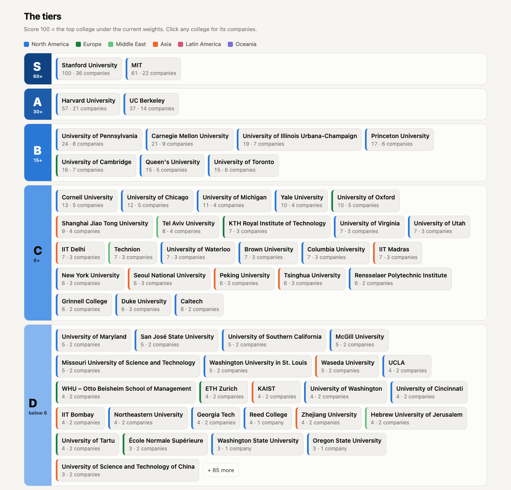
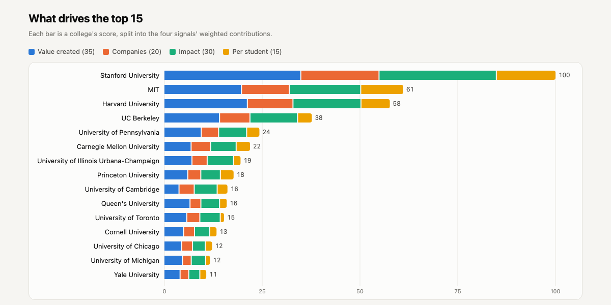
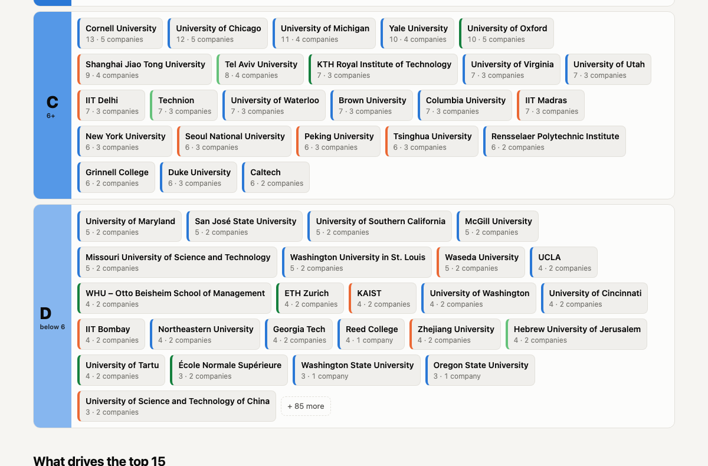

# Startup College Tier List

Which colleges produce the founders of the world's most ambitious, influential and useful companies? An adjustable tier list built from 172 landmark companies and their 321 founders, across 144 colleges in 22 countries.

- [Live site](https://amalmehta.github.io/StartUpRankingTierColleges/)
- [Instructions](docs/INSTRUCTIONS.md): how to set it up, run it and use it
- [System Design](docs/SYSTEM-DESIGN.md): how it works and why
- [File Structure](docs/FILE-STRUCTURE.md): what's where
