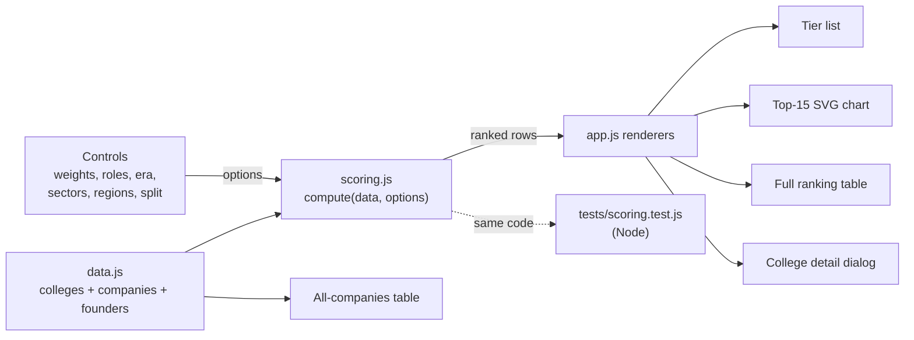

# System Design

## What it is

A static website that ranks colleges by how many of the world's most ambitious, influential and useful companies their alumni founded. It groups colleges into S to D tiers. Visitors can re-weight the ranking and filter it, and the page re-ranks instantly in the browser. There's no server, no build step and no third-party code.

## Architecture

## Components

| Component | Job |
|---|---|
| `site/data.js` | The dataset. `colleges`: id → name, country, region, approximate enrollment. `companies`: name, year, sector, peak value, 1–5 impact score, one-line reason, and founders, each with the colleges they attended and how (`ug`, `grad`, `left`). Exposes `RANKING_DATA` in the browser and `module.exports` in Node. |
| `site/scoring.js` | Pure function `compute(data, options)`. Turns the dataset plus options into ranked rows with raw signals, normalized signals, weighted contributions, score, tier and rank. No DOM access, so the same code runs in the page and in the tests. |
| `site/app.js` | Owns UI state, builds the controls, and calls `compute` on every change. Renders the tier list, chart, table and detail dialog, and handles the chart tooltip. |
| `site/styles.css` | Color tokens for light and dark mode, layout and components. |
| `tests/scoring.test.js` | Node `node:test` suite: data integrity plus scoring behaviour. |

## Main flows

1. **Load**: `index.html` loads `data.js`, then `scoring.js`, then `app.js` as classic scripts. `app.js` builds the controls, renders the static all-companies table and runs the first `update()`.
2. **Change a control**: the handler mutates `state` and calls `update()`. That runs `compute(DATA, options())`, syncs the controls, and re-renders the tiers, chart and table. With about 130 companies, this takes well under a frame.
3. **Explore a college**: clicking a tier card, chart bar or table row opens a `<dialog>`. It shows the four signals, then each credited company with its founders and how they attended.

## Scoring

For each company that passes the era and sector filters, the college credits come from the founders' links whose role is enabled, de-duplicated so a company counts once per college. If regions are filtered, only colleges in those regions get credit. Each credited college receives a share of the company: 1, or 1/n with *split credit* on.

| Signal | Per college |
|---|---|
| Value created | Σ share × log₂(1 + peak value in $B) |
| Companies | Σ share |
| Impact | Σ share × impact (1–5) |
| Per student | Impact ÷ (enrollment / 10,000 + 2) |

Each signal is scaled so the top college gets 100. The score is the weight-averaged result, rescaled so the leader is 100. Tiers: S ≥ 60, A ≥ 30, B ≥ 15, C ≥ 6, D below that.

## Hosting

GitHub Pages, deployed by a GitHub Actions workflow (`.github/workflows/pages.yml`). Each push to `main` runs `npm test`, then uploads `site/` as the Pages artifact. Pages only serves from the repo root or `/docs` when deploying from a branch, so the workflow lets the site stay in `site/` while `docs/` holds documentation.

## Where data lives

All data is in `site/data.js`, version-controlled with the code. Nothing is fetched at runtime, and nothing is stored: control state resets on reload, which is deliberate for a read-only report.

## Key decisions and trade-offs

- **Curated landmark list, not a database export.** Unicorn databases (PitchBook, Crunchbase) are paywalled and skew toward recent funding rounds. A hand-picked list of companies that changed things fits the brief ("ambitious, influential, useful") better and is fully inspectable. The cost is selection bias and a small sample.
- **Log-damped value.** Raw market cap would let Apple alone outweigh dozens of companies. log₂(1 + $B) keeps scale visible but makes breadth matter.
- **An impact score alongside value.** Value misses things like YouTube, DeepMind, WhatsApp and Netscape, which were acquired early or cheaply but reshaped the world. The 1–5 score captures that, at the cost of being a judgment call. Users can set its weight to zero.
- **Smoothed per-student rate.** Plain impact ÷ enrollment would put a 1,500-student college with one famous dropout at the top. Adding 20,000 students to every denominator dampens that while still rewarding small, productive colleges.
- **Full credit by default.** A founder's undergrad and grad schools both plausibly shaped them. The split-credit toggle is there for people who disagree.
- **Relative tiers.** Thresholds apply to a score where the leader is 100, so tiers stay meaningful under any weights or filters.
- **No framework, no build, classic scripts.** It works from `file://`, hosts anywhere static, and has nothing to update. The chart is hand-built SVG.
- **Colors.** Chart signals use a validated, colorblind-safe categorical order. Sectors share hue families by kinship (blue = AI, software and security; violet = chips and devices; orange = internet and media; amber = commerce and retail; green = finance; pink = biotech and medtech; teal = space, energy and transport). Each mode gets its own shade steps, and text always uses text colors.

## How it's tested

- `npm test` runs `tests/scoring.test.js` with Node's built-in runner. It covers data integrity, rank ordering, contributions summing to the score, tier thresholds, de-duplication of multi-founder companies, role toggles, split credit, era, sector and region filters, and zero-weight safety. It also checks that Stanford, MIT and Harvard lead under the defaults.
- The page was checked in a browser in light and dark mode, at desktop and 375px phone width (no horizontal scroll), with filters, the detail dialog and chart tooltips exercised, and no console errors.

## Known limits

- **Sample bias.** About 130 companies, chosen by hand, mostly US-centric and well-known. Colleges outside the US, especially in China and India, are probably under-counted.
- **Judgment calls.** Impact scores are subjective. Founder lists include the best-documented founders, not every co-founder.
- **Approximate numbers.** Peak values (market cap, private valuation or acquisition price) and enrollments are rounded figures from public reporting up to late 2025. They are not live.
- **Edge cases in attribution.** Elon Musk's two years at Queen's University count as "left" and lift Queen's noticeably. His two days at Stanford are deliberately not counted. Turn off "left" to remove dropout and transfer effects.
- **Correlation, not causation.** Selective colleges admit ambitious people. This measures where founders studied, not what the college added.
